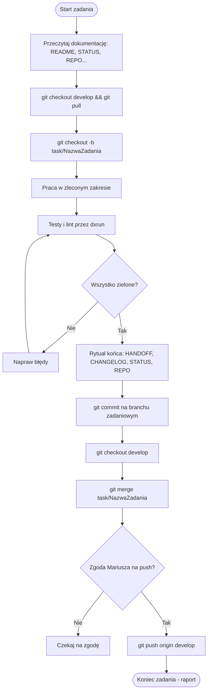

# GIT-FLOW.md — zasady pracy z repozytorium

## 1. Złote zasady
- **Testy blokują commit:** Przed commitem pełny zestaw testów (`dxrun -- ...`) musi być zielony.
- **Commit agent robi sam:** Po zielonych testach i rytuale końca agent commituje bez pytania.
- **Push jest zablokowany:** `git push` wymaga bezwzględnie osobnej, wyraźnej zgody Mariusza na czacie.
- **Zakaz destrukcji:** Zakaz `git push --force`, `git restore`, `git reset --hard`, `git clean -f`.
- **Sekrety:** Absolutny zakaz commitowania `.env`, kluczy i haseł.
- **Pliki chronione:** `GIT-FLOW.md` i `AGENTS.md` edytuje wyłącznie człowiek.
- **Obowiązkowy podpis commitu:**
  ```text
  Co-Authored-By: Dostawca Model 5.5 <noreply@model.com>
  ```

---

## 2. Schemat cyklu pracy (Develop Flow)

```text
pull develop -> newbranch from develop TaskName -> end work, only all tests green ->
commit -> change branch to develop -> merge TaskName to develop -> push to Github (za zgodą)
```

### Krok po kroku:
1. **Start:** 
   - Przeczytaj: `README.md`, `STATUS.md`, `GIT-FLOW.md`, `AGENTS.md`, `HANDOFF.md`, `CHANGELOG.md`, `REPO.md`.
   - Zaktualizuj develop i stwórz branch zadaniowy:
     `git checkout develop && git pull`
     `git checkout -b task/NazwaZadania`
2. **Praca:** Wykonaj wyłącznie zlecone zadanie.
3. **Weryfikacja:** Uruchom testy i lint przez `dxrun`. Wszystko musi być zielone.
4. **Rytuał końca (przed commitem):**
   - `HANDOFF.md` – pałeczka dla następnej sesji.
   - `CHANGELOG.md` – historia zmian (append-only).
   - `STATUS.md` – bieżący stan projektu i najbliższy krok.
   - `REPO.md` – notes techniczny: jak działa nowy mechanizm i jakie są pułapki (append-only).
5. **Commit:** Agent wykonuje commit na branchu zadaniowym (samodzielnie, z podpisem Co-Authored-By).
6. **Merge do develop:**
   `git checkout develop && git merge task/NazwaZadania`
7. **Push:** Zgłoś gotowość i zapytaj Mariusza o zgodę na push do zdalnego repozytorium.

---

## 3. Diagram przepływu pracy


